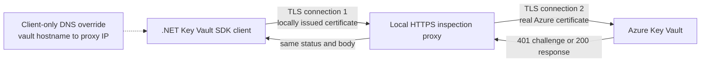
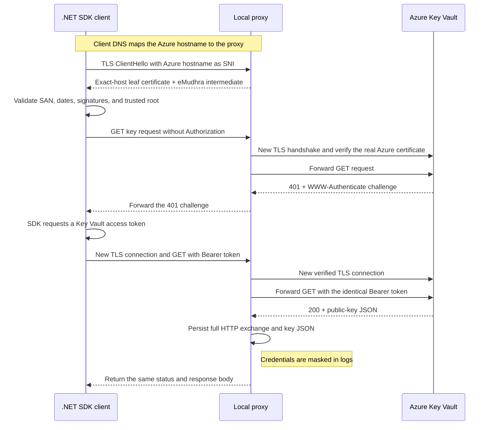
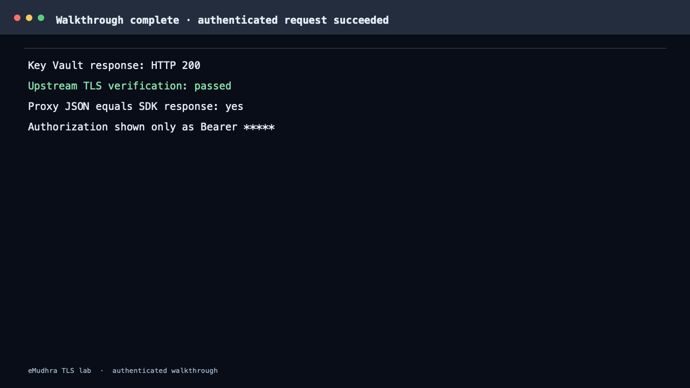

# eMudhra TLS Interception Lab

This repository documents a controlled local experiment that tested whether a
.NET Azure Key Vault client would accept a server certificate issued through an
eMudhra intermediate CA and send an authenticated request through a local HTTPS
inspection proxy.

The test succeeded for the pinned Azure Linux/.NET container used in the lab.
The client accepted the locally generated certificate, the proxy received the
decrypted Key Vault request, forwarded the same bearer token to Azure over a new
TLS connection, and returned Azure's response to the client.

This did not break TLS encryption. The experiment worked because the client
trusted the certificate chain presented by the proxy and because DNS resolution
inside the client container was deliberately redirected to that proxy.

## Architecture

The setup uses two Colima containers:

- **SDK client:** a .NET 8 application using `Azure.Security.KeyVault.Keys` and
  `KeyClient.GetKeyAsync`.
- **Inspection proxy:** a local HTTPS server that terminates the client's TLS
  connection, records redacted HTTP details, and opens a separate verified TLS
  connection to the real Azure Key Vault service.

Only the SDK client receives the hostname override. The proxy resolves the real
Azure hostname normally.



The proxy is a TLS endpoint on the first connection and a TLS client on the
second connection. Consequently, it can inspect the plaintext HTTP request and
the bearer token between the two encrypted connections.

```text
SDK client  === encrypted TLS 1 ===>  proxy  === encrypted TLS 2 ===>  Azure
                                         |
                              HTTP and token are visible
```

## Request sequence

Azure Key Vault uses challenge-based authentication. A new SDK client normally
sends an unauthenticated request first, receives Azure's authentication
challenge, obtains a token, and retries the request.



### 1. Client-to-proxy TLS handshake

The client requests:

```text
https://labkeyvault1022.vault.azure.net/
```

Inside the client container, that hostname resolves to the proxy's private
container address. The URL and hostname do not change, so the TLS ClientHello
still contains `labkeyvault1022.vault.azure.net` as Server Name Indication
(SNI).

The proxy presents:

```text
labkeyvault1022.vault.azure.net leaf certificate
    └── EM DV TLS CA - G3B intermediate
            └── AAA Certificate Services root
```

The leaf certificate contains the exact vault hostname in its Subject
Alternative Name. The .NET client checks the hostname, certificate dates,
signatures, key usage, and chain. In the observed test, platform validation
returned `SslPolicyErrors.None`; no certificate-validation bypass was used.

### 2. Initial Key Vault request

After TLS is established, the SDK sends the Key Vault request without an access
token. The proxy decrypts it, creates an independent TLS connection to the real
Azure endpoint, verifies Azure's genuine certificate, and forwards the request.

Azure responds with HTTP `401` and a `WWW-Authenticate` challenge. The proxy
returns that response to the SDK.

### 3. Authenticated retry

The SDK processes the challenge and asks its credential provider for a token
scoped to:

```text
https://vault.azure.net/.default
```

It retries the request with:

```http
Authorization: Bearer <access-token>
```

The proxy can read this header because it terminates the first TLS connection.
It copies the header value unchanged into the request sent through its separate
verified TLS connection to Azure.

### 4. Response path

Azure authenticates the token and returns the requested key's public data. Before
replying to the SDK, the proxy persists the complete decrypted HTTP exchange. The
authorization header is logged as `Bearer *****`, and any occurrence of the token
elsewhere is replaced with `*****`. It also saves the full, pretty-printed
key JSON as `logs/proxy/latest-key-response.json` and archives it by request ID.
Only after those writes succeed does it return the same HTTP status and response
body to the SDK client. If persistence fails, the proxy returns an error instead
of forwarding the Key Vault response.

`GetKeyAsync` returns only the public portion and metadata for the Key Vault key.
The private key is not exported.

## What the experiment demonstrated

The live run established all of the following:

- The client-only DNS override routed the Azure hostname to the local proxy.
- The client accepted the proxy certificate using normal .NET/Linux certificate
  validation.
- The presented chain terminated at a root already present in the container's
  trust store.
- The proxy received and decrypted both the unauthenticated request and the
  authenticated retry.
- The proxy forwarded the same bearer token to the fixed Azure Key Vault
  endpoint.
- The proxy independently verified Azure's genuine TLS certificate.
- Azure returned HTTP `200`.
- The JSON received by the SDK matched the response captured by the proxy.
- The bearer-token value was absent from the saved logs and represented as
  `Bearer *****` in the captured request.
- The full key response was stored on the proxy before delivery to the client.

## Security boundaries

The bearer token remains encrypted on both network segments, but it is not
end-to-end encrypted through the proxy. It exists as plaintext in the proxy's
process memory while the request is forwarded.

The proxy is deliberately constrained to one hostname, one key version, one API
version, and the `GET` method. It does not follow redirects automatically. Its
logs redact authorization and cookie values, and its outgoing Azure connection
uses normal system certificate verification.

The client network has no direct Internet egress. Only the proxy joins both the
private client network and an egress network. The proxy is not published on a
host port.

## Scope and limitations

This result applies to the pinned .NET 8/Azure Linux container tested in this
lab. The image was .NET/ASP.NET 8.0.31 for ARM64, built on October 13, 2026. It
was selected as a pre-October-16 image, but it was not proven to be the exact
moving-tag digest served on October 16.

The result does not establish how Chrome, another browser, another operating
system, an application with certificate pinning, or a client with explicit
online revocation checks would behave. It demonstrates default .NET/Linux trust
validation in this specific image and configuration.

## Walkthrough video

[](docs/media/authenticated-walkthrough.mp4)

[Download or play the 90-second authenticated walkthrough](docs/media/authenticated-walkthrough.mp4). It is a paced terminal-style rendering of selected output from a live `python3 keyvault-proxy/walkthrough.py --no-pause` run. It shows the already-public compromised eMudhra intermediate CA private key, the authenticated SDK request, and the complete public Key Vault JSON captured by the proxy and returned to the SDK. The long RSA modulus is wrapped across video lines for readability, with every character retained. Bearer tokens are masked as `Bearer *****` throughout.

## Repository layout

The runnable implementation is in:

```text
keyvault-proxy/
```

The published eMudhra intermediate certificates and corresponding compromised
private keys used by this lab are intentionally tracked under
`ca/intermediate/` so the experiment is reproducible. They must be used only in
an isolated lab. Locally generated leaf material under `ca/website/`, runtime
TLS material, Azure access tokens, and captured traffic remain excluded by the
repository-wide `.gitignore`.
